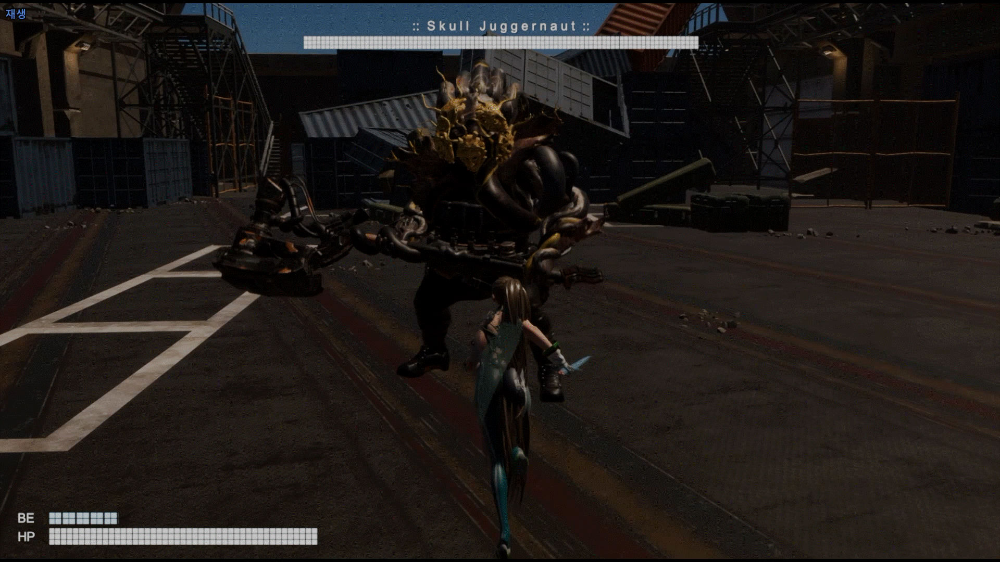

# ProjectE

《스텔라 블레이드》의 캐릭터 이동과 보스 전투를 Unity에서 재현한 개인 모작 프로젝트임. 이동·전투 입력부터 일반·퍼펙트 가드, 반격, 회피와 보스 마무리 연출까지 연결한 3인칭 액션 프로토타입으로, Unity Play Mode에서 주요 동작을 확인했음.

## 프로젝트 정보

| 구분 | 내용 |
| --- | --- |
| 개발 기간 | 2026.04–2026.11 |
| 장르·플랫폼 | 3인칭 액션 · PC |
| 엔진·언어 | Unity 6000.3.12f · C# |
| 3D 그래픽 도구 | Blender |
| AI 모델 | GPT-6 Luna · GPT-6.2 Astra |

## 플레이 흐름

**이동 → 공격·방어 → 반격 → 마무리** 순서로 전투를 진행함. 플레이어는 보스의 연속 공격을 가드하거나 타이밍을 맞춰 퍼펙트 가드하고, 열린 반격 구간에서 공격을 이어감. 보스가 보내는 특수 공격 신호에는 방향 입력과 회피 키로 대응함.

## 구현 범위

- **캐릭터 이동과 상태 전환**: 카메라 기준 이동, 달리기, 점프·이단 점프, 전투 이동과 가드 이동을 상태에 따라 연결했음.
- **공격 콤보**: 약공격·강공격 입력으로 콤보를 이어주고, 검의 이동 경로를 샘플링해 공격 애니메이션 구간에서만 보스에게 피해를 적용했음.
- **가드와 반격**: E키로 가드를 유지하며 각 타격을 개별 판정함. 가드 입력 직후 정해진 타이밍 창에 들어온 공격은 퍼펙트 가드로 처리하고, 보스의 공격 방향에 따라 좌우 반응 애니메이션을 재생함. 퍼펙트 가드 뒤에는 좌·우 공격 입력으로 반격 콤보를 이어가며 베타 에너지를 소모함.
- **회피와 특수 대응**: Left Shift를 눌러 방향 회피하고, 이동 중 유지하면 전력 질주함. 보스의 블링크 신호에는 W + Left Shift, 리펄스 신호에는 S + Left Shift로 대응하도록 구성했음.
- **보스 행동**: 행동 트리가 우선순위에 따라 대기·공격·경직·사망 상태를 처리함. 일반 연속 공격과 블링크·리펄스 공격을 구성하고 도끼의 실제 궤적을 따라 접촉을 판정함.
- **전투 피드백과 마무리**: 플레이어·보스 체력과 베타 에너지 UI, 피격·가드 신호의 효과음과 시각 효과, 플레이어 사망과 Game Over, 보스 처치 후 마무리 연출을 연결했음.
- **전투 카메라**: 마우스로 시점을 조작하고 ESC로 커서를 해제함. 반격과 마무리 구간에서는 캐릭터와 보스가 화면에 들어오도록 카메라를 별도 연출함.

## 설계와 역할

Shared·Logic·Runtime 어셈블리로 책임을 나누었음. Shared는 `IInputReader`, `IPlayerMovementController`, `IAnimationController` 같은 인터페이스를 정의하고, Logic은 `StateMachine`과 상태 클래스로 전환 규칙을 처리함. Runtime의 `PlayerLocomotionController`는 씬 컴포넌트를 찾아 상태를 구성하고 두 계층을 연결함. 의존은 Runtime → Logic → Shared와 Runtime → Shared 방향으로 제한했음.

- **직접 설계·구현**: 캐릭터 이동, 상태 전환의 큰 틀, 애니메이션 제어와 Shared·Logic·Runtime 어셈블리 구분을 맡았음.
- **AI가 주로 구현**: Root Motion 적용과 전투 애니메이션 연결 이후의 가드·패링, 회피, 보스 행동, 전투 UI와 마무리 연출을 맡겼음.
- **직접 확인·보완**: Unity Play Mode에서 입력과 애니메이션 결과를 재현했음. 예상과 달랐던 부분은 발생 조건과 기대 동작을 정리해 수정 방향에 반영했음.

## 문제 해결 사례

- **Root Motion 위치 불일치**: 공격 중 메시와 캐릭터 컨트롤러의 이동이 어긋나거나 애니메이션 종료 때 위치가 당겨지는 현상을 확인했음. 약공격을 기준으로 이동 축과 종료 위치를 비교하고, 빈 공간과 보스 앞 충돌 상황을 별도 조건으로 나눠 확인했음.
- **연속 타격 가드**: 가드를 유지해도 보스의 세 번 공격 중 한 번만 방어되는 문제를 발견했음. 공격 애니메이션을 세 타격 구간으로 나누고, 각 구간의 방어와 타이밍 입력에 따른 퍼펙트 가드 결과를 반복 확인하도록 요구사항을 구체화했음.

자세한 내용은 [Root Motion 사례](root-motion-case.md)와 [연속 타격 가드·패링 사례](guard-parry-case.md)에 정리했음.

## 전투 장면

### 일반 가드

### 퍼펙트 가드

### 패링 반격

## 관련 문서

- [기반 시스템과 어셈블리 구분](architecture.md)
- [Root Motion 재생 문제 해결](root-motion-case.md)
- [연속 타격 가드·패링 문제](guard-parry-case.md)
- [AI 협업 작업 흐름](ai-collaboration.md)
- [저장소 공개 범위](asset-policy.md)

## 저장소 구성

프로젝트 소개와 개발 사례 문서, 일반 가드·패링·퍼펙트 가드 캡처 GIF를 담았음. Unity 프로젝트와 C# 소스, 원작 캐릭터·몬스터 모델, 애니메이션, 사운드, 텍스처, 추출 파일과 원본 영상은 포함하지 않았음. 실행 파일과 프로젝트 소스가 없어 이 저장소만으로 빌드할 수 없음.
