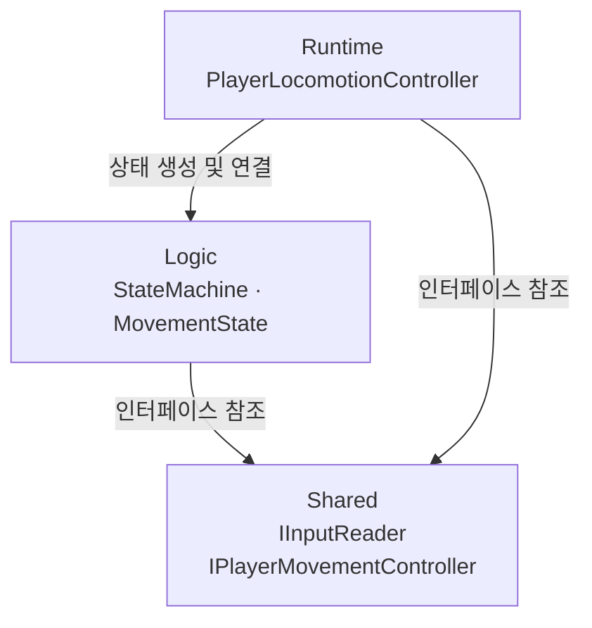

# 기반 시스템과 어셈블리 구분

캐릭터 이동의 상태 전환과 씬 컴포넌트 연결을 분리하기 위해 Shared, Logic, Runtime 어셈블리로 구분했음.

- **Shared**: 입력과 이동 제어에 필요한 인터페이스를 정의했음.
- **Logic**: `StateMachine`과 `MovementState`가 상태 전환과 이동 처리 요청을 담당했음.
- **Runtime**: `PlayerLocomotionController`가 씬 컴포넌트를 연결하고 상태 생성 시 필요한 참조를 전달했음.

화살표는 참조하는 쪽에서 참조 대상 쪽을 향함. Runtime이 씬에 있는 구체 컴포넌트를 찾아 Logic에 연결하고, Logic은 Shared 인터페이스를 통해 필요한 동작을 요청하는 구조임.
